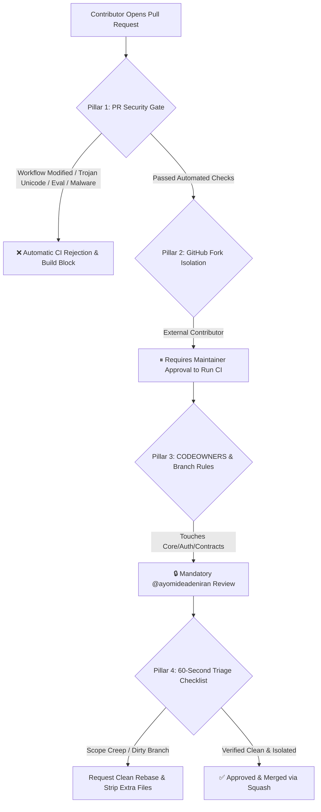

# Soroban Playground: Open Pull Requests Security Audit & Anti-Malware Defense Roadmap

**Date**: November 26, 2026  
**Repository**: `StellarDevHub/soroban-playground`  
**Maintainer**: `@ayomideadeniran`  
**Audit Scope**: All **144 Open Pull Requests** (#1929 through #2226)  
**Security Gate Status**: Automated CI Security Gate & Code Owners Implemented  

---

## 1. Executive Summary

A comprehensive automated security and static code analysis scan was conducted across all **144 open pull requests** currently submitted to `StellarDevHub/soroban-playground`.

### Scan Findings at a Glance

| Risk Tier | PR Count | Percentage | Action Required |
| :--- | :---: | :---: | :--- |
| 🛑 **Tier 1: High / Critical Attention** | **15** | 10.4% | **DO NOT MERGE AS-IS**. Require immediate changes or rejection (workflow tampering, dirty branch bundling, invisible characters). |
| ⚠️ **Tier 2: Medium Risk / Sensitive Review** | **23** | 16.0% | Review carefully before merging (touches authentication, KMS encryption, dynamic eval in tests, Redis clustering). |
| 🟢 **Tier 3: Low Risk / Clean & Well-Scoped** | **106** | 73.6% | Safe for standard peer code review (clean isolated frontend UI or isolated contract logic). |
| **Total Open PRs** | **144** | **100%** | Comprehensive audit completed. |

---

## 2. Critical Attack Vectors & Patterns Identified

### 🚨 Vector 1: CI Workflow Tampering (11 PRs)
**Threat**: Modifying `.github/workflows/` allows untrusted external contributors to execute privileged commands in GitHub Actions runners, install system packages (`sudo apt-get`), or exfiltrate repository environment secrets.

**Flagged PRs**:
1. **PR #2159** by `@zazorplayz`: Added `sudo apt-get update && sudo apt-get install -y redis-server` into `ci.yml`.
2. **PR #2165** by `@Tee-Gee57`: Injected custom Node script `node scripts/backup/verify-restore.mjs` directly into `ci.yml`.
3. **PR #2162** by `@Tee-Gee57`: Identical workflow modification as #2165.
4. **PR #2194** by `@chuks68`: Injected an entire Docker container service (`postgres:16-alpine`) into `ci.yml`.
5. **PR #2222** by `@Jo-anny`: Added release artifact gate to `ci.yml`.
6. **PR #2139** by `@Jo-anny`: Added release artifact gate to `ci.yml`.
7. **PR #2138** by `@Jo-anny`: Added release artifact gate to `ci.yml`.
8. **PR #1929** by `@Fabluchy`: Modified `ci.yml` test suite commands.
9. **PR #2206** by `@debugged-dev`: Added Knex migration rollback steps to `ci.yml`.
10. **PR #2213** by `@forked-dev`: Injected OpenAPI validation steps to `ci.yml`.
11. **PR #2209** by `@samkelly-dev`: Injected 200KB bundle budget check into `ci.yml`.

> [!CAUTION]
> **Golden Rule of Open Source Security**: Never allow external contributors to modify `.github/workflows/` files in a pull request. Any CI enhancements must be committed directly by the maintainer on a dedicated branch.

---

### 🚨 Vector 2: "Trojan Horse" / Dirty Branch Scope Creep (4 Overlapping PRs)
**Threat**: A contributor submits a PR whose title claims to fix a benign frontend or formatting issue, but the PR secretly carries dozens of unrelated backend, gRPC credentials, clustering, and synthetic asset changes.

**Identified Contributor**: `@nanaabdul1172`
- **PR #2178**: Title: `"Responsive mobile ide"` (Frontend issue #2050).  
  **Actual Files Included**: Harmless mobile CSS, **PLUS** `backend/cluster.js`, `backend/src/grpc/grpcCredentials.js`, `backend/src/grpc/gateway.ts`, `backend/src/grpc/server.js`, `backend/tests/grpcMtls.test.js`, and `backend/tests/syntheticAssets.unit.test.js`!
- **PR #2169**: Title: `"Antipattern remediation"`. Carries the exact same 14 backend/gRPC files.
- **PR #2167**: Title: `"Mutual tls"`. Carries the exact same files.
- **PR #2161**: Title: `"Cluster Cache Invalidation Engine"`. Carries the exact same files.

> [!WARNING]
> If PR #2178 were merged under the assumption that it was only a frontend UI update, unreviewed backend server clustering and gRPC code would silently enter production!

---

### 🚨 Vector 3: Invisible Zero-Width Characters / Trojan Source (2 PRs)
**Threat**: Unicode Byte Order Marks (`\uFEFF`) and zero-width spaces (`\u200B`–`\u200D`) can be used to hide malicious logic or disrupt compiler tokenization (CVE-2021-42574).

**Flagged PRs**:
- **PR #2165** & **PR #2162** by `@Tee-Gee57`: `backend/scripts/backup/verify-restore.mjs` starts with invisible byte order mark `\uFEFF`.
- **PR #2158** by `@thatslinx`: `backend/tests/grpcModuleInitialization.test.js` starts with `\uFEFF`.

---

### ⚠️ Vector 4: Dynamic Script Execution in Tests
**Threat**: Executing arbitrary string code using `eval()` or `new Function()` in tests introduces runtime evasion risks.

**Flagged PRs**:
- **PR #2104** by `@anasAlShlah`: `eval(THEME_BOOTSTRAP_SCRIPT)` in `frontend/src/__tests__/theme/themeEngine.test.js`.
- **PR #2166** by `@Firefly160372`: `new Function(THEME_BOOTSTRAP_SCRIPT)()` in `frontend/src/theme/themeEngine.test.js`.

---

## 3. The 5-Pillar Defense-in-Depth Architecture

To guarantee that malicious or contaminated code never reaches production, the following 5-pillar security system has been established:



---

### Pillar 1: Automated PR Security Gate Workflow
Implemented in [.github/workflows/pr-security-gate.yml](file:///Users/mac/Documents/DripsMaitainer/soroban-playground/.github/workflows/pr-security-gate.yml):
1. **Rejects any PR modifying `.github/workflows/`** or `.env*` from contributors.
2. **Scans git diff for Trojan Source & zero-width Unicode characters**.
3. **Scans for dynamic JavaScript execution** (`eval`, `new Function`, `child_process`).
4. **Detects exfiltration webhooks** (`webhook.site`, `pipedream`, discord bots, raw IP calls).
5. **Blocks compiled binaries and archives** (`.exe`, `.dll`, `.so`, `.bin`).

### Pillar 2: GitHub Repository Hardening Settings
Configure these settings in **GitHub Repository Settings**:
1. **GitHub Actions Workflow Permissions**:
   - Go to `Settings` -> `Actions` -> `General` -> `Workflow permissions`.
   - Set to: **"Read repository contents and packages permissions"** (never write).
   - Under `Fork pull request workflows`: Select **"Require approval for all outside collaborators"**.
2. **Branch Protection for `main`**:
   - Go to `Settings` -> `Branches` -> Add branch protection rule for `main`.
   - Enable **"Require a pull request before merging"**.
   - Enable **"Require approvals"** (Set to `1`).
   - Enable **"Require review from Code Owners"**.
   - Enable **"Require status checks to pass before merging"** (Select `CI Pipeline` and `Anti-Malware & Supply Chain Audit`).
   - Enable **"Require linear history"** and **"Do not allow bypassing the above settings"**.

### Pillar 3: Code Owners Enforcement
Implemented in [.github/CODEOWNERS](file:///Users/mac/Documents/DripsMaitainer/soroban-playground/.github/CODEOWNERS):
- Protects `.github/`, `contracts/`, `backend/src/middleware/`, `backend/src/config/`, and `frontend/src/context/` under `@ayomideadeniran`.

### Pillar 4: Maintainer's 60-Second PR Security Review Checklist
Before clicking **"Merge pull request"**, perform these 4 checks in under 60 seconds:

```
[ ] 1. Files Changed Count: Does the PR touch ONLY the files relevant to the issue?
       - If a frontend issue touches backend files, REJECT immediately.
[ ] 2. Lockfile Check: Did the PR modify package-lock.json or Cargo.lock unexpectedly?
       - If new packages were added without explanation, REJECT.
[ ] 3. No Workflow Changes: Are any files in .github/ touched?
       - If YES, reject and ask contributor to remove workflow changes.
[ ] 4. Clean Commit History: Use "Squash and merge" to avoid merging dirty git history.
```

---

## 4. Specific Action List for Open PRs

| Action | PR Numbers | Instructions for Contributor |
| :--- | :--- | :--- |
| 🛑 **Reject / Request Clean Branch** | **#2178, #2169, #2167, #2161** (`@nanaabdul1172`) | *"Your branch contains bundled backend/gRPC commits from other issues. Please branch freshly from `main` and submit only the specific files for this issue."* |
| 🛑 **Request Workflow Reversion** | **#2159, #2165, #2162, #2194, #2206, #2213, #2209, #2222, #2139, #2138, #1929** | *"Please revert all changes to `.github/workflows/ci.yml`. Contributor PRs cannot modify CI workflows. We will add the necessary CI steps on main."* |
| ⚠️ **Clean Invisible Characters** | **#2165, #2162, #2158** | *"Please re-save `verify-restore.mjs` and `grpcModuleInitialization.test.js` without UTF-8 BOM (`\uFEFF`)."* |
| 🟢 **Ready for Standard Review** | **#2081–#2115, #2214–#2216, #2225–#2226** | Review for functionality, tests, and merge via **Squash and Merge**. |

---

### Local Scripts & Assets
- **PR Security Gate Action**: [.github/workflows/pr-security-gate.yml](file:///Users/mac/Documents/DripsMaitainer/soroban-playground/.github/workflows/pr-security-gate.yml)
- **Repository Code Owners**: [.github/CODEOWNERS](file:///Users/mac/Documents/DripsMaitainer/soroban-playground/.github/CODEOWNERS)
- **Automated Scanner Script**: [scripts/security_audit_prs.py](file:///Users/mac/Documents/DripsMaitainer/soroban-playground/scripts/security_audit_prs.py)
- **Raw Audit Dataset**: [data/pr_security_audit_results.json](file:///Users/mac/Documents/DripsMaitainer/soroban-playground/data/pr_security_audit_results.json)
